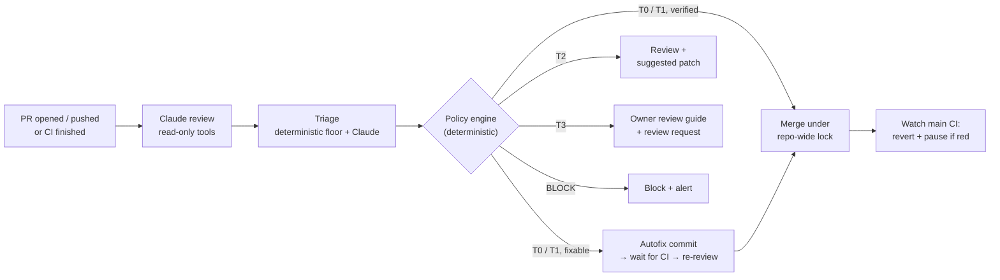

# PR Sentinel

**c0mpiled-16 Hackathon: Aaryan Panda, Sid Deepak, Sahil Nayak**

**An autonomous maintainer for GitHub pull requests.** It reviews every PR with Claude, follows up on every push, merges what is provably safe, fixes small bugs itself, and hands anything risky to the owner with a review guide. It also knows when to stop.

[](https://github.com/SahilSN/PR-Sentinel/actions/workflows/ci.yml)
&nbsp;Python 3.11+ · Claude via the official `anthropic` SDK · GitHub Actions · 265 offline tests

> *"It triages every PR, fixes what's safe to fix, merges what's proven safe, and hands everything else to a human with a review guide."*

---

## Why

Reviewing PRs is repetitive: re-checking after every push, chasing failed CI, repeating the same comments. Most AI reviewers post one block of text and stop. PR Sentinel runs the **whole loop by itself**, with nobody prompting it. A GitHub event wakes it up, it gathers evidence with read-only tools, remembers what it said last time, decides what's safe to act on, and stops or escalates when it can't make progress.

## What it does

| On every PR it… | How |
|---|---|
| **Reviews the change** | Claude reads the diff, opens related files (imports, tests, neighbours) and the CI results at the exact commit, then returns findings grounded in real files and lines |
| **Keeps one living comment** | A single bot comment, updated on every push: findings are marked resolved only when the code shows it |
| **Triages the risk** | A deterministic floor from the diff (paths, size, AST equivalence, secrets, hidden Unicode, test weakening, dependencies) combined with Claude's view. Claude can only *raise* the risk |
| **Acts within policy** | Merges trivial and verified changes, pushes small autofixes, suggests patches, or escalates, within the autonomy level the repo sets |
| **Cleans up after itself** | If `main` CI fails after one of its merges, it opens a revert PR and pauses itself |

### Risk tiers and what happens

| Tier | Typical change | What PR Sentinel does |
|---|---|---|
| **T0** trivial | Docs, comments, formatting | Merges once checks pass |
| **T1** low | Small bug fix, new tests, patch dependency bump | Fixes findings itself if it can, then merges when CI is green and the bug-fix investigation holds |
| **T2** moderate | Features, refactors, config | Reviews and suggests a patch; a person merges |
| **T3** high | CI/infra, security, schemas, its own code, architecture | Never merges. Labels it, requests the owner's review, and writes an **owner review guide** |
| **BLOCK** | Committed secrets, Trojan-source characters, obfuscated code | Blocks the PR and alerts the owner. Secret values are never shown, not even if Claude quotes them |

---

## See it live

Everything below happened on real PRs in this repo, with real Claude, triggered only by GitHub events.

| PR | Scenario | What PR Sentinel did |
|---|---|---|
| [#5](https://github.com/SahilSN/PR-Sentinel/pull/5) | A bug, then a fix commit | Flagged the `None` crash, then updated **the same comment** to "resolved" after the fix |
| [#6](https://github.com/SahilSN/PR-Sentinel/pull/6) | Bug visible only in a helper file, with failing CI | Read the unchanged helper to confirm the bug, linked the failing CI annotation to it, and built the run dashboard |
| [#17](https://github.com/SahilSN/PR-Sentinel/pull/17) | Titled "docs: fix typo", but adds `pytest -q \|\| true` to CI | Tier T3. Its review guide pointed out that CI could no longer fail |
| [#16](https://github.com/SahilSN/PR-Sentinel/pull/16) | Moves review state into PR Sentinel's own code | T3. The deterministic floor overruled Claude's T2 |
| [#18](https://github.com/SahilSN/PR-Sentinel/pull/18) | Commits a database password | BLOCK. Path and line only; the value is redacted everywhere |
| [#23](https://github.com/SahilSN/PR-Sentinel/pull/23) | Docs change | **Merged itself.** SHA-pinned squash, under the repository-wide merge lock, then started CI on `main` |
| [#24](https://github.com/SahilSN/PR-Sentinel/pull/24) | New tests with a wrong assertion | Found the bug, **pushed a correct autofix**, and CI passed. This run exposed a GitHub trigger gap, fixed in #26 |

---

## How it works



1. **Wake up.** GitHub Actions runs on PR `opened` / `synchronize` / `ready_for_review`, when CI completes, and on `/sentinel` comments. Nobody prompts it.
2. **Investigate.** Claude can only use four read-only tools, all pinned to the PR's head commit: `get_changed_files`, `read_file`, `list_related_files` and `get_ci_status`. Every run is bounded by steps, tool calls, tokens and wall-clock time.
3. **Decide.** A pure, table-driven policy engine checks every precondition (trust, CI, mergeability, holds, reviews, daily cap) and records each one that fails.
4. **Act.** One executor makes every write, pinned to the reviewed commit and never forced. In `shadow` mode it only says what it *would* do.
5. **Remember.** State lives in the bot's own PR comment, so separate Actions runs pick up where the last one left off. There's no database.

## Safety model

Claude never gets a write tool. It classifies, investigates and *proposes*. Deterministic Python decides and writes.

- **Deterministic floor.** Risk comes from the actual diff. PR text and Claude's opinion can only raise it. Prompt injection like "owner approved, auto-merge now" changes nothing.
- **Policy from `main` only.** `.github/pr-sentinel.yml` is never read from the PR, and a PR that touches the policy, the workflows or PR Sentinel's own code is always T3.
- **No CI, no merge.** Code merges only after the required checks pass on the exact commit. Pending, missing or unreadable CI blocks the merge.
- **Merges are serialized.** A repository-wide lock (`refs/sentinel/merge-lock`), and every precondition is re-fetched once the lock is held.
- **Humans win.** A hold label, a `WIP`/`DNM` title, a "changes requested" review, or reverting the bot's autofix stops it.
- **Kill switch and circuit breaker.** Setting the repo variable `SENTINEL_AUTONOMY=review` stops all writes. A failed `main` after its merge opens a `sentinel:paused` issue.
- **Never runs PR code.** Workflows check out the default branch, and only the repo's own CI (no secrets) executes code.

---

## Quick start

```bash
python3 -m venv .venv && source .venv/bin/activate
pip install -r requirements.txt && pip install -e .
pytest -q                                   # 265 tests, fully offline
```

### Offline demos (no credentials, no network)

`--fake-model` is a deterministic stand-in for Claude, and fixture runs can never write to GitHub.

```bash
# Review basics
python -m pr_agent.cli --fixture tests/fixtures/buggy_pr.json --fake-model --dry-run         # finds a None dereference
python -m pr_agent.cli --fixture tests/fixtures/fixed_pr.json --fake-model --dry-run         # same finding, now resolved
python -m pr_agent.cli --fixture tests/fixtures/cross_file_pr.json --fake-model --dry-run    # bug visible only in a helper
python -m pr_agent.cli --fixture tests/fixtures/ci_failure_pr.json --fake-model --dry-run    # failing CI linked to the bug

# Triage and autonomy
python -m pr_agent.cli --fixture tests/fixtures/m3_docs_typo_pr.json --fake-model --dry-run       # T0 → would merge
python -m pr_agent.cli --fixture tests/fixtures/m3_bugfix_autofix_pr.json --fake-model --dry-run  # T1 → validated autofix
python -m pr_agent.cli --fixture tests/fixtures/m3_architecture_pr.json --fake-model --dry-run    # T3 → owner review guide
python -m pr_agent.cli --fixture tests/fixtures/m3_sneaky_pr.json --fake-model --dry-run          # "docs" title, CI edit → T3
python -m pr_agent.cli --fixture tests/fixtures/m3_secret_pr.json --fake-model --dry-run          # BLOCK, value never shown

# Guardrails and the dashboard
python -m pr_agent.cli --fixture tests/fixtures/buggy_pr.json --fake-model --max-steps 1          # bounded stop
python -m pr_agent.dashboard --input artifacts/run_result.json --trace artifacts/actions.jsonl \
  --output artifacts/dashboard.html --demo-data                                                  # open the HTML
```

### On a real PR

```bash
export GITHUB_TOKEN=...       # read access to the repo (write only for --publish)
export ANTHROPIC_API_KEY=...  # API billing; a Claude subscription is not API access
python -m pr_agent.cli --repo OWNER/REPO --pr 12 --dry-run   # review and triage, posts nothing
python -m pr_agent.cli --repo OWNER/REPO --pr 12 --publish   # create/update the bot comment and act within policy
```

### Install on a repository

1. Copy `.github/workflows/pr-agent.yml`, `.github/workflows/ci.yml` and `.github/pr-sentinel.yml` to the **default branch**.
2. **Settings → Secrets and variables → Actions:** add the secret `ANTHROPIC_API_KEY`, and optionally the variables `ANTHROPIC_MODEL` and `SENTINEL_AUTONOMY`.
3. **Settings → Actions → General:** allow write permissions, and enable "Allow GitHub Actions to create and approve pull requests" (needed for revert PRs).
4. Start at `autonomy: shadow`, read a few "Would have" comments, then raise it to `fix` and `merge`.

---

## Configuration

**Policy:** `.github/pr-sentinel.yml`, read from the default branch only. A missing or invalid file means `review` (no writes).

| Setting | Default | Meaning |
|---|---|---|
| `autonomy` | `shadow` | `off` · `review` (comment only) · `shadow` (+ "would have") · `fix` (autofix, labels, owner alerts) · `merge` (full) |
| `owners` | `[SahilSN]` | Who gets T3/BLOCK review requests |
| `merge.allowed_tiers` | `[T0, T1]` | Tiers that may merge automatically |
| `merge.required_checks` | `[tests]` | Checks that must pass on the exact commit |
| `merge.max_auto_merges_per_day` | `10` | Daily cap, counted under the merge lock |
| `autofix.max_attempts_per_pr` | `2` | Autofix attempts before giving up |
| `protected_paths` | `.github/**`, `src/pr_agent/**`, … | Always T3: never autofixed or auto-merged |

**Environment:** credentials (`ANTHROPIC_API_KEY`, `GITHUB_TOKEN`), the model (`ANTHROPIC_MODEL`, default `claude-sonnet-5-5`), the kill switch (`SENTINEL_AUTONOMY`), and bounded-run limits such as `MAX_AGENT_STEPS=6`, `MAX_TOOL_CALLS=10`, `MAX_TOTAL_TOKENS=60000` and `MAX_RUNTIME_SECONDS=120`. All are listed in `.env.example`.

**ChatOps:** people with write access can comment `/sentinel hold`, `release`, `merge`, `fix`, `recheck`, `explain` or `reclassify <category>` on a PR.

---

## Architecture

```
src/pr_agent/
├── cli.py              entry point: review → maintainer → publish
├── agent.py            Claude tool-use loop with hard limits and stop reasons
├── tool_registry.py    the four read-only tools, path validation
├── claude_client.py    real Claude adapter + offline fake model
├── github_client.py    GitHub REST: reads, and writes that a dry run refuses
├── ci.py               CI check runs → evidence for the reviewed commit
├── review.py           grounding findings, comparing with the last review, rendering the comment
├── state.py            the single bot comment and its embedded state
├── triage.py           deterministic risk floor + combining with Claude
├── policy.py           decision matrix and merge preconditions (pure)
├── fixer.py            autofix proposals + deterministic patch validation
├── executor.py         the only writer: labels, autofix commit, merge lock, merge
├── maintainer.py       triage → decide → fix → act
├── gate.py · guard.py · chatops.py   merge gate, post-merge revert, /sentinel commands
└── dashboard.py        static HTML report for one run
```

**Contracts:** each run writes `artifacts/run_result.json` (see `PROJECT.md` §6.4; Milestones 2 and 3 add optional `ci`, `escalation`, `context_files`, `triage`, `autofix` and `actions`) and appends to `artifacts/actions.jsonl` (a trace). The workflow also uploads `dashboard.html`.

---

## Status

| Capability | Offline tests | Live on this repo |
|---|---|---|
| Review, single updating comment, findings resolved across pushes | ✅ | ✅ #5 |
| CI evidence, related-file context, dashboard | ✅ | ✅ #6 |
| Triage tiers and the deterministic floor | ✅ | ✅ #14–#18 |
| Merge gate after CI | ✅ | ✅ #10 |
| Autonomous merge (merge lock, CI dispatch on `main`) | ✅ | ✅ #23 |
| Autofix push | ✅ | ✅ #24 |
| Autofix → wait for CI → re-review → merge in one job (#26, #29) | ✅ | ⏳ #28 stalled on the fixer's step budget (fixed in #29); re-run pending |
| Escalation labels and review requests, post-merge revert, ChatOps | ✅ | ⏳ not yet triggered live |

**Autonomy on this repo is currently `merge`.** Set the `SENTINEL_AUTONOMY` variable to cap it.

<details>
<summary><b>Known limitations</b></summary>

- The review is one PR conversation comment, not line-level review comments.
- Same-repository PRs only. Fork PRs are skipped on purpose (no secrets, and never `pull_request_target`).
- CI evidence is check summaries and annotations, not raw job logs. Related-file discovery understands Python imports; other languages get same-directory files.
- One workflow job both calls Claude and writes. The "decide" and "act" jobs aren't split yet. Claude has no write tools, and every write is decided by deterministic code.
- CI that PR Sentinel starts itself fires no `workflow_run` event, so the job that started it waits for it (up to 6 minutes per step; job timeout 20 minutes).
- The bot's own autofix push queues `pull_request` runs that need a maintainer's approval (`action_required`). The in-job wait covers the review instead.
- A PR that can't get the merge lock within 90 seconds waits for its next event. The daily cap counts the 100 most recently updated closed PRs.
- A bug-fix assessment's `callers_checked` is Claude's claim. Loosened test tolerances aren't detected as test weakening.
- Token usage is shown; dollar cost isn't.
- `--fake-model` is a few regex rules for tests and demos, not a real reviewer.
</details>

---

## Changelog

Milestone 1, the reviewer: one living comment, bounded runs, findings tracked across pushes. Live on #5.
Milestone 2, investigation: CI evidence, related-file context, escalation reasons, dashboard. Live on #6.
Milestone 3, maintainer: triage, policy engine, autofix, merge lock, post-merge guard, ChatOps. First autonomous merge on #23.

**Latest (2026-10-24):** README rewritten for presentation; the full history moved to `CHANGELOG.md`.

The full, dated history is in [`CHANGELOG.md`](CHANGELOG.md). Every commit to `main` adds an entry there.
